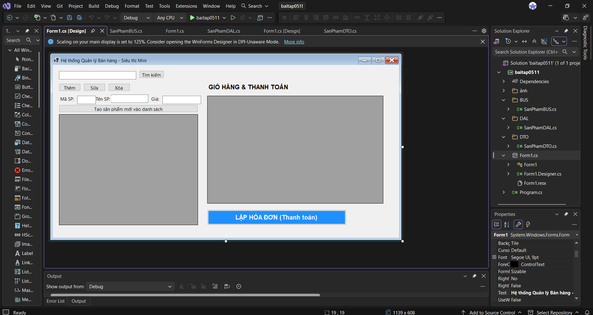
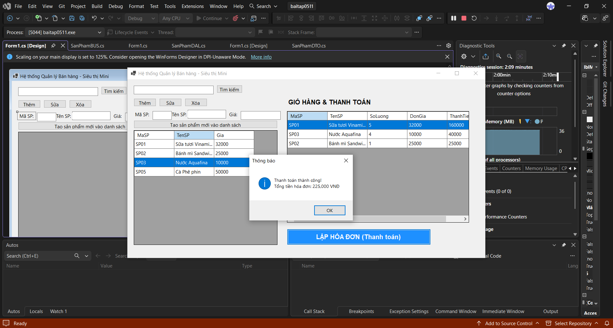
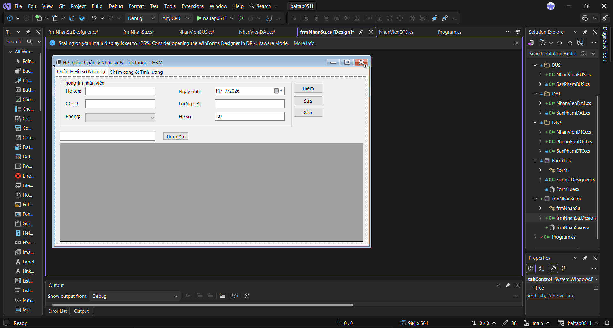
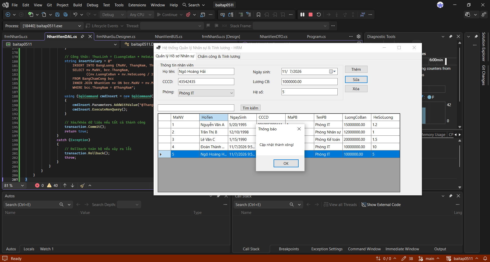
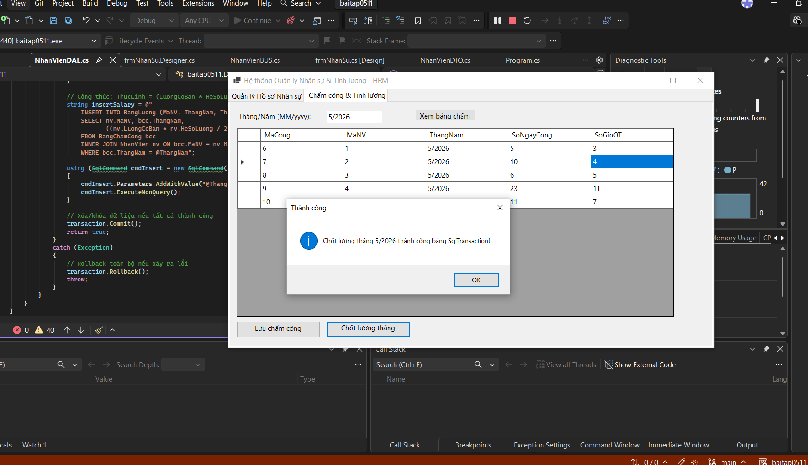
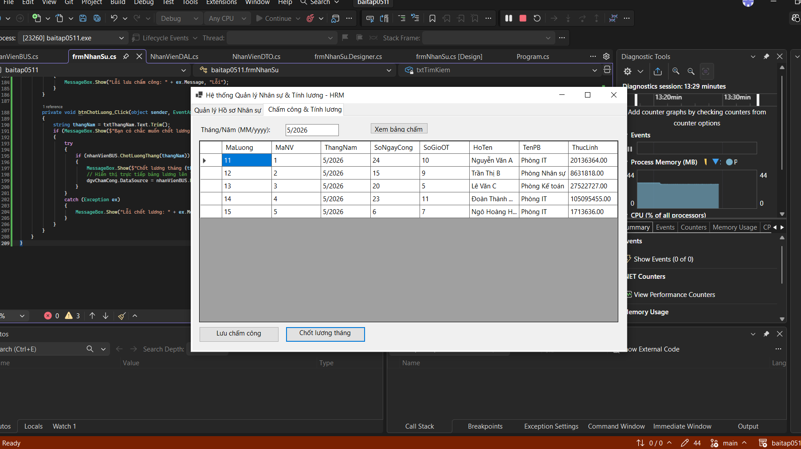

# BÁO CÁO BÀI TẬP / ĐỒ ÁN

## THÔNG TIN SINH VIÊN
- **Họ và tên:** Đoàn Thành Đạt
- **Mã số sinh viên:** 24810320056
- **Lớp:** D19QTANM!
- **Tên môn học:** Lập trình .NET / Windows Form

---

## KẾT QUẢ THỰC HÀNH

### Bai 6.1

### 1. Ảnh màn hình Giao diện chính

### 2. Ảnh màn hình Chức năng thực thi / Kết quả

### Bai 6.2

### 1. Ảnh màn hình Giao diện chính

### 2.1  Ảnh màn hình Chức năng thực thi / Kết quả

### 2.2  Ảnh chấm công

### 2.3  Ảnh bảng lương

